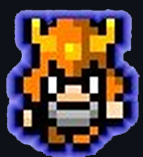
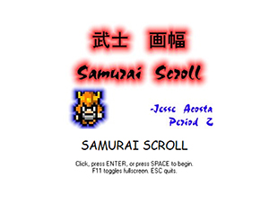
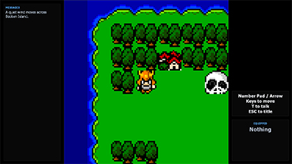

# 𝐒𝐚𝐦𝐮𝐫𝐚𝐢 𝐒𝐜𝐫𝐨𝐥𝐥 𝐖𝐢𝐧𝟑𝟐

<!--
Samurai Scroll Win32 is a C port of a small tile-based RPG from
1999. It was originally written in VB6 by Jesse Acosta. The idea 
is to preserve this little gem before it disappears from the 
Internet.
-->
𝚂𝚊𝚖𝚞𝚛𝚊𝚒 𝚂𝚌𝚛𝚘𝚕𝚕 𝚆𝚒𝚗𝟹𝟸 𝚒𝚜 𝚊 𝙲 𝚙𝚘𝚛𝚝 𝚘𝚏 𝚊 𝚜𝚖𝚊𝚕𝚕 𝚝𝚒𝚕𝚎-𝚋𝚊𝚜𝚎𝚍 𝚁𝙿𝙶 𝚏𝚛𝚘𝚖
𝟷𝟿𝟿𝟿. 𝙸𝚝 𝚠𝚊𝚜 𝚘𝚛𝚒𝚐𝚒𝚗𝚊𝚕𝚕𝚢 𝚠𝚛𝚒𝚝𝚝𝚎𝚗 𝚒𝚗 𝚅𝙱𝟼 𝚋𝚢 𝙹𝚎𝚜𝚜𝚎 𝙰𝚌𝚘𝚜𝚝𝚊. 𝚃𝚑𝚎 𝚒𝚍𝚎𝚊
𝚒𝚜 𝚝𝚘 𝚙𝚛𝚎𝚜𝚎𝚛𝚟𝚎 𝚝𝚑𝚒𝚜 𝚕𝚒𝚝𝚝𝚕𝚎 𝚐𝚎𝚖 𝚋𝚎𝚏𝚘𝚛𝚎 𝚒𝚝 𝚍𝚒𝚜𝚊𝚙𝚙𝚎𝚊𝚛𝚜 𝚏𝚛𝚘𝚖 𝚝𝚑𝚎
𝙸𝚗𝚝𝚎𝚛𝚗𝚎𝚝.

<!--
This version retains the graphics and gameplay while adding full-screen 
and some fun improvements that fit within the spirit of the original. 
You can use F11 to toggle to windowed-mode, which makes it identical 
to Jesse's original.
-->
𝚃𝚑𝚒𝚜 𝚟𝚎𝚛𝚜𝚒𝚘𝚗 𝚛𝚎𝚝𝚊𝚒𝚗𝚜 𝚝𝚑𝚎 𝚐𝚛𝚊𝚙𝚑𝚒𝚌𝚜 𝚊𝚗𝚍 𝚐𝚊𝚖𝚎𝚙𝚕𝚊𝚢 𝚠𝚑𝚒𝚕𝚎 𝚊𝚍𝚍𝚒𝚗𝚐 𝚏𝚞𝚕𝚕-𝚜𝚌𝚛𝚎𝚎𝚗 
𝚊𝚗𝚍 𝚜𝚘𝚖𝚎 𝚏𝚞𝚗 𝚒𝚖𝚙𝚛𝚘𝚟𝚎𝚖𝚎𝚗𝚝𝚜 𝚝𝚑𝚊𝚝 𝚏𝚒𝚝 𝚠𝚒𝚝𝚑𝚒𝚗 𝚝𝚑𝚎 𝚜𝚙𝚒𝚛𝚒𝚝 𝚘𝚏 𝚝𝚑𝚎 𝚘𝚛𝚒𝚐𝚒𝚗𝚊𝚕. 
𝚈𝚘𝚞 𝚌𝚊𝚗 𝚞𝚜𝚎 𝙵𝟷𝟷 𝚝𝚘 𝚝𝚘𝚐𝚐𝚕𝚎 𝚝𝚘 𝚠𝚒𝚗𝚍𝚘𝚠𝚎𝚍-𝚖𝚘𝚍𝚎, 𝚠𝚑𝚒𝚌𝚑 𝚖𝚊𝚔𝚎𝚜 𝚒𝚝 𝚒𝚍𝚎𝚗𝚝𝚒𝚌𝚊𝚕 
𝚝𝚘 𝙹𝚎𝚜𝚜𝚎'𝚜 𝚘𝚛𝚒𝚐𝚒𝚗𝚊𝚕.

<!--
While indeed a short game, Samurai Scroll has charm and replayability.
-->
𝚆𝚑𝚒𝚕𝚎 𝚒𝚗𝚍𝚎𝚎𝚍 𝚊 𝚜𝚑𝚘𝚛𝚝 𝚐𝚊𝚖𝚎, 𝚂𝚊𝚖𝚞𝚛𝚊𝚒 𝚂𝚌𝚛𝚘𝚕𝚕 𝚑𝚊𝚜 𝚌𝚑𝚊𝚛𝚖 𝚊𝚗𝚍 𝚛𝚎𝚙𝚕𝚊𝚢𝚊𝚋𝚒𝚕𝚒𝚝𝚢.

<table>
    <tr>
        <td align="left" width="40%" valign="top">
             
        </td>
        <td align="left" width="50%" valign="center">
             
        </td>
    </tr>
</table>

<!--
It is my hope that Samurai Scroll will continue to inspire those interested 
in making a small tile-based game, as it has done for me. Some fun experiments 
might be changing the graphics, changing the music, changing the title screen
-- all easily done without a single line of code.

If you'd like to modify the code and rebuild, you can use Visual Studio. Once 
VS is installed, from command prompt run build_msvc.bat.

You can modify the map in the file modSamuraiGame.c - good luck!

Samurai Scroll Win32 runs on Windows 7 through 11.
-->
𝙸𝚝 𝚒𝚜 𝚖𝚢 𝚑𝚘𝚙𝚎 𝚝𝚑𝚊𝚝 𝚂𝚊𝚖𝚞𝚛𝚊𝚒 𝚂𝚌𝚛𝚘𝚕𝚕 𝚠𝚒𝚕𝚕 𝚌𝚘𝚗𝚝𝚒𝚗𝚞𝚎 𝚝𝚘 𝚒𝚗𝚜𝚙𝚒𝚛𝚎 𝚝𝚑𝚘𝚜𝚎 𝚒𝚗𝚝𝚎𝚛𝚎𝚜𝚝𝚎𝚍 
𝚒𝚗 𝚖𝚊𝚔𝚒𝚗𝚐 𝚊 𝚜𝚖𝚊𝚕𝚕 𝚝𝚒𝚕𝚎-𝚋𝚊𝚜𝚎𝚍 𝚐𝚊𝚖𝚎, 𝚊𝚜 𝚒𝚝 𝚑𝚊𝚜 𝚍𝚘𝚗𝚎 𝚏𝚘𝚛 𝚖𝚎. 𝚂𝚘𝚖𝚎 𝚏𝚞𝚗 𝚎𝚡𝚙𝚎𝚛𝚒𝚖𝚎𝚗𝚝𝚜 
𝚖𝚒𝚐𝚑𝚝 𝚋𝚎 𝚌𝚑𝚊𝚗𝚐𝚒𝚗𝚐 𝚝𝚑𝚎 𝚐𝚛𝚊𝚙𝚑𝚒𝚌𝚜, 𝚌𝚑𝚊𝚗𝚐𝚒𝚗𝚐 𝚝𝚑𝚎 𝚖𝚞𝚜𝚒𝚌, 𝚌𝚑𝚊𝚗𝚐𝚒𝚗𝚐 𝚝𝚑𝚎 𝚝𝚒𝚝𝚕𝚎 𝚜𝚌𝚛𝚎𝚎𝚗
-- 𝚊𝚕𝚕 𝚎𝚊𝚜𝚒𝚕𝚢 𝚍𝚘𝚗𝚎 𝚠𝚒𝚝𝚑𝚘𝚞𝚝 𝚊 𝚜𝚒𝚗𝚐𝚕𝚎 𝚕𝚒𝚗𝚎 𝚘𝚏 𝚌𝚘𝚍𝚎.

𝙸𝚏 𝚢𝚘𝚞'𝚍 𝚕𝚒𝚔𝚎 𝚝𝚘 𝚖𝚘𝚍𝚒𝚏𝚢 𝚝𝚑𝚎 𝚌𝚘𝚍𝚎 𝚊𝚗𝚍 𝚛𝚎𝚋𝚞𝚒𝚕𝚍, 𝚢𝚘𝚞 𝚌𝚊𝚗 𝚞𝚜𝚎 𝚅𝚒𝚜𝚞𝚊𝚕 𝚂𝚝𝚞𝚍𝚒𝚘. 𝙾𝚗𝚌𝚎 
𝚅𝚂 𝚒𝚜 𝚒𝚗𝚜𝚝𝚊𝚕𝚕𝚎𝚍, 𝚏𝚛𝚘𝚖 𝚌𝚘𝚖𝚖𝚊𝚗𝚍 𝚙𝚛𝚘𝚖𝚙𝚝 𝚛𝚞𝚗 𝚋𝚞𝚒𝚕𝚍_𝚖𝚜𝚟𝚌.𝚋𝚊𝚝.

𝚈𝚘𝚞 𝚌𝚊𝚗 𝚖𝚘𝚍𝚒𝚏𝚢 𝚝𝚑𝚎 𝚖𝚊𝚙 𝚒𝚗 𝚝𝚑𝚎 𝚏𝚒𝚕𝚎 𝚖𝚘𝚍𝚂𝚊𝚖𝚞𝚛𝚊𝚒𝙶𝚊𝚖𝚎.𝚌 - 𝚐𝚘𝚘𝚍 𝚕𝚞𝚌𝚔!

𝚂𝚊𝚖𝚞𝚛𝚊𝚒 𝚂𝚌𝚛𝚘𝚕𝚕 𝚆𝚒𝚗𝟹𝟸 𝚛𝚞𝚗𝚜 𝚘𝚗 𝚆𝚒𝚗𝚍𝚘𝚠𝚜 𝟽 𝚝𝚑𝚛𝚘𝚞𝚐𝚑 𝟷𝟷.
